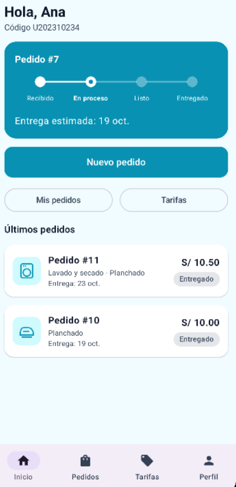
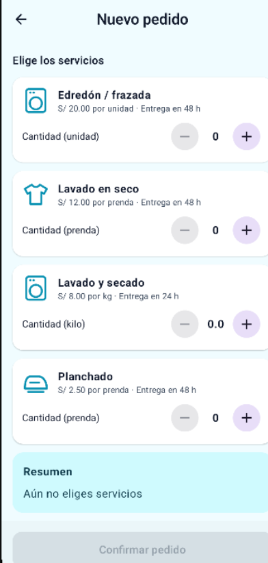
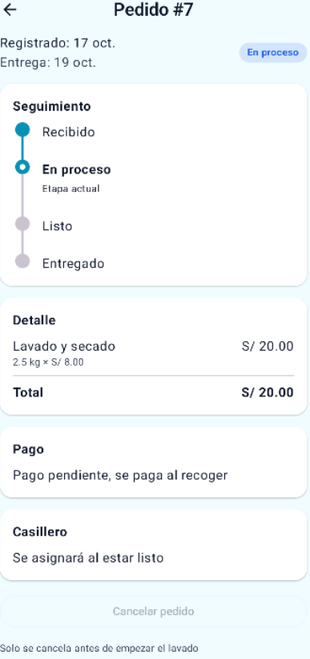
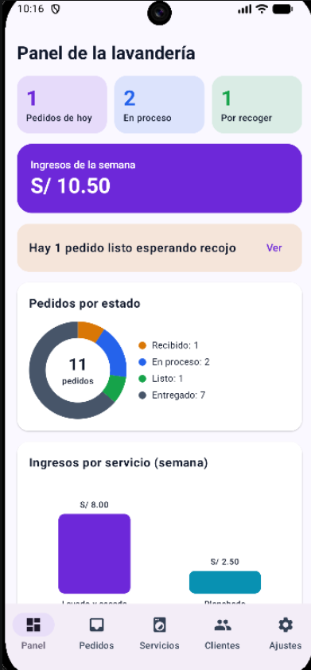
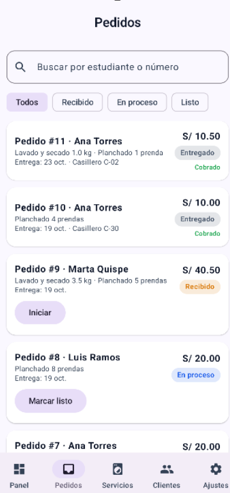
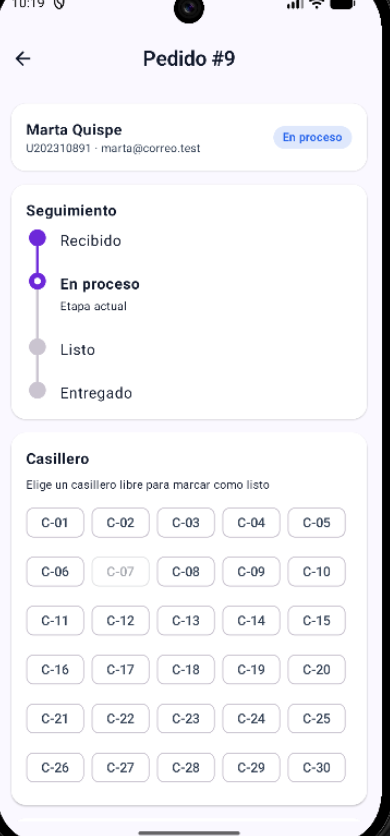
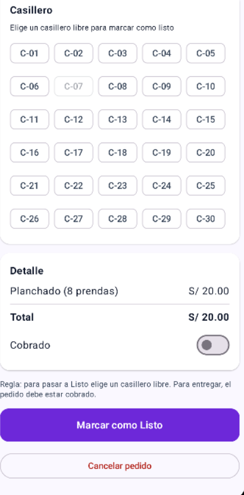

# LavaCampus

App Android de una **lavandería universitaria** con dos perfiles en el mismo dispositivo.

- **Estudiante:** arma pedidos eligiendo servicios y cantidades (kilos o prendas), ve el total y la fecha estimada de entrega, sigue el estado de su ropa y la recoge en un casillero.
- **Administrador:** recibe los pedidos, los avanza de estado (Recibido → En proceso → Listo → Entregado), asigna casillero, cobra, administra las tarifas y consulta a sus clientes.

Ambos perfiles comparten la misma base de datos Room: cuando el administrador marca un pedido como Listo, el estudiante lo ve con su casillero al instante.

Laboratorio Semana 08 · TECSUP · Programación en Móviles · Docente: Juan León S.
Todos los datos son ficticios (Ley 29733).

## Tecnologías

- Kotlin + Jetpack Compose + Material 3 (sin XML)
- Room (base local `lavacampus.db`) con KSP
- DataStore Preferences (perfil activo, modo oscuro, avisos, recibir pedidos)
- Navigation Compose
- Patrón MVVM + Repository (interface)

> **Nota de versiones:** el PDF indica Room 2.6.1, pero el Android Studio utilizado trae AGP 9.2.1 y Kotlin 2.2.10, que exigen KSP 2.3.6. Por compatibilidad se usó Room 2.8.4 (el código del laboratorio es el mismo). `compileSdk` = 37, `minSdk` = 26.

## Usuarios de prueba

| Perfil | Correo | Clave |
|---|---|---|
| Estudiante | ana@correo.test | 1234 |
| Estudiante | luis@correo.test | 1234 |
| Estudiante | marta@correo.test | 1234 |
| Administrador | admin@lavacampus.test | admin |

## Arquitectura MVVM + Repository

```
VIEW (Composable)
   │ eventos (clics)        ▲ collectAsState()
   ▼                        │
VIEWMODEL (StateFlow + reglas de negocio)
   │ llama                  ▲ Flow / resultados
   ▼                        │
LavaRepository (interface)
   │ la implementa
   ▼
LavaRepositoryRoom ──► DAO ──► SQLite (lavacampus.db)

DataStore (solo preferencias) ──► ViewModel
```

| Capa | Conoce a | No debe |
|---|---|---|
| View (`ui/`) | Solo a su ViewModel | Usar DAO, Repository ni reglas de negocio |
| ViewModel | Solo a la interface `LavaRepository` | Conocer Composables ni DAOs |
| Repository | Los DAOs (en la implementación) | Conocer pantallas ni ViewModels |
| DAO / Room | SQL y entidades | Conocer ViewModels |

## Base de datos

| Tabla | Descripción |
|---|---|
| `usuarios` | Estudiantes y administrador (`rol`: CLIENTE / ADMIN) |
| `servicios` | Tarifas (unidad KG / PRENDA / UNIDAD, precio, horas de entrega, activo, ícono) |
| `pedidos` | Pedido de un usuario (estado, total, casillero, pagado, fechas) |
| `detalles_pedido` | Líneas del pedido con `precioUnitario` y `subtotal` congelados |

Relaciones: un estudiante tiene N pedidos, un pedido tiene N detalles y cada detalle apunta a un servicio.

## Estructura de paquetes

```
com.tecsup.lavacampus
├── MainActivity.kt
├── LavaApp.kt
├── data
│   ├── local
│   │   ├── entity      Servicio, Usuario, Pedido, DetallePedido
│   │   ├── dao         ServicioDao, UsuarioDao, PedidoDao, DetalleDao
│   │   ├── relation    DetalleConServicio, PedidoConDetalle
│   │   ├── LavaDatabase.kt
│   │   └── DatosIniciales.kt
│   ├── repository      LavaRepository (interface), LavaRepositoryRoom
│   └── prefs           PreferenciasStore (DataStore)
├── model               Rol, EstadoPedido, Unidad, LineaPedido,
│                       IngresoServicio, ClienteResumen, Casilleros
├── viewmodel           LavaViewModelFactory, Sesion, Inicio, NuevoPedido,
│                       MisPedidos, DetallePedido, Tarifas, Perfil,
│                       Panel, Bandeja, GestionPedido, Servicios, Clientes
└── ui
    ├── theme           Color, Type, Theme (LavaTheme por rol)
    ├── components      AppTopBar, LavaButton, LavaTextField, EstadoPedidoChip,
    │   │               PedidoCard, StepperEstado, IconoServicio,
    │   │               SelectorCantidad, Avatar, FilaSwitch, Formato
    │   └── graficos    GraficoDona, GraficoBarras, DatoGrafico
    ├── navigation      Rutas, NavLava
    ├── estudiante      Splash, Login, Inicio, NuevoPedido, DetallePedido,
    │                   MisPedidos, Tarifas, Perfil
    └── administrador   Panel, Bandeja, GestionPedido, Servicios,
                        FormularioServicio, Clientes, Ajustes
```

## Reglas de negocio (resumen)

- El estudiante solo ve sus pedidos; el administrador ve todos.
- Cantidades: KG de 1.0 a 10.0 en pasos de 0.5; PRENDA y UNIDAD enteros de 1 a 30.
- Máximo 3 pedidos activos por estudiante.
- Total = suma de cantidad × precio, congelado en el detalle.
- Fecha de entrega = hoy + mayor tiempo de entrega; si cae domingo pasa al lunes.
- El pedido y sus líneas se guardan en una sola transacción.
- Cancelar: el estudiante solo en Recibido; el administrador en Recibido o En proceso.
- Pasar a Listo exige un casillero libre (C-01 a C-30); pasar a Entregado exige pedido cobrado.
- Un servicio usado en algún pedido no se elimina, solo se desactiva.

## Capturas

### Estudiante

| Inicio | Nuevo pedido | Detalle del pedido |
|---|---|---|
|  |  |  |

### Administrador

| Panel | Bandeja |
|---|---|
|  |  |

| Gestión del pedido (casilleros) | Gestión del pedido (cobro y acciones) |
|---|---|
|  |  |

## Para pensar

**¿Por qué el pedido y sus líneas van en tablas separadas?**
Un pedido puede tener varios servicios. Guardar cada línea en `detalles_pedido` evita columnas repetidas y permite consultar ingresos por servicio con `GROUP BY`.

**¿Por qué guardar `precioUnitario` y `subtotal` en el detalle?**
Es una foto del momento. Si el precio del servicio cambia, los pedidos antiguos conservan lo que costaron y los ingresos del panel no se alteran.

**¿Por qué el Repository es una interface?**
Para poder cambiar la implementación (por ejemplo, un servicio web o la nube) sin modificar ViewModels ni pantallas.

**¿Cuándo usar `Flow` y cuándo `suspend`?**
Una lectura que debe actualizar la pantalla es `Flow`; una escritura o acción única es `suspend`. Se complementan.

**¿Por qué las reglas viven en el ViewModel?**
Porque la View solo muestra y el DAO solo accede a datos; así las reglas se prueban y se reutilizan sin depender de la interfaz ni de SQL.