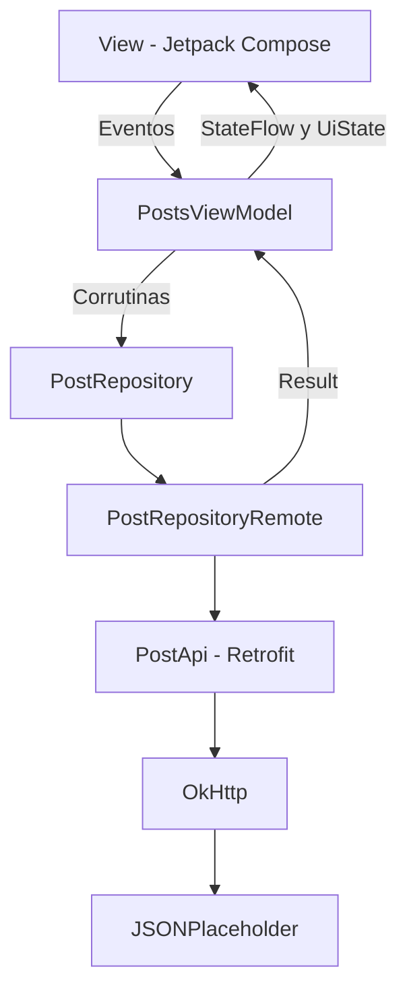
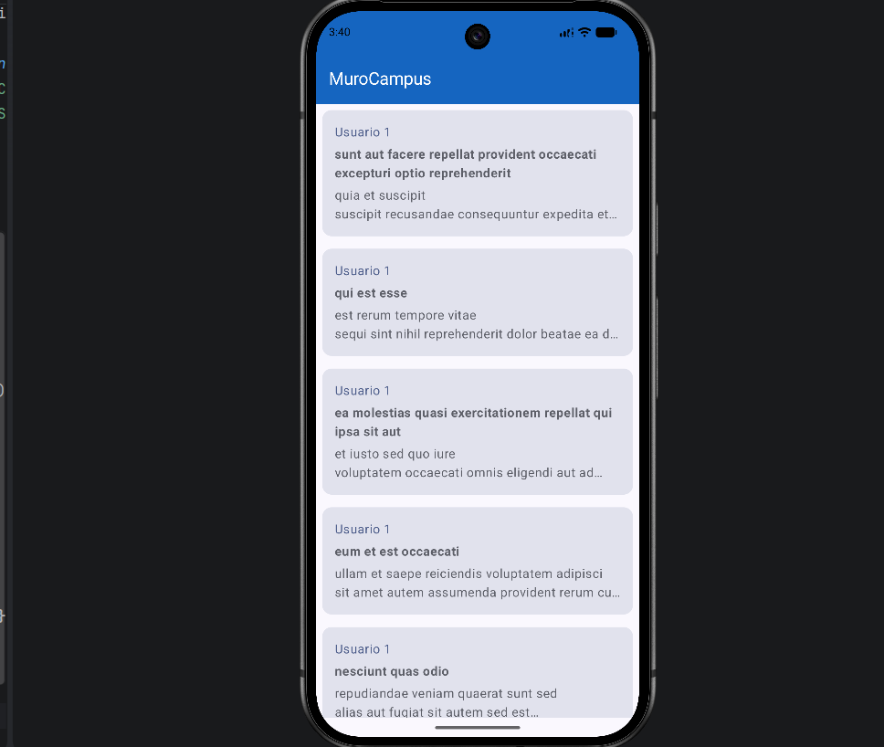
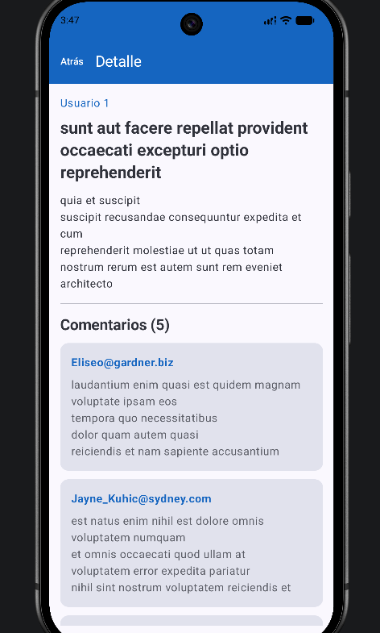
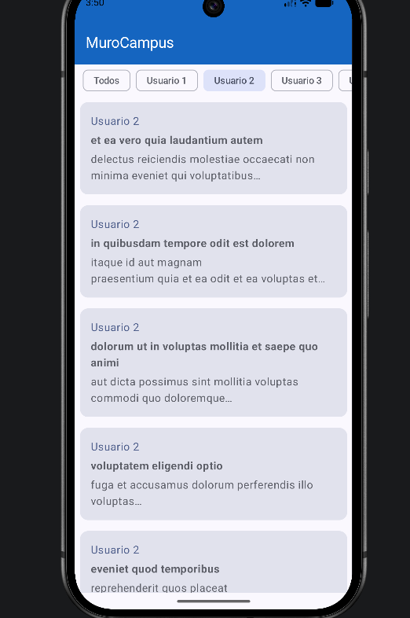
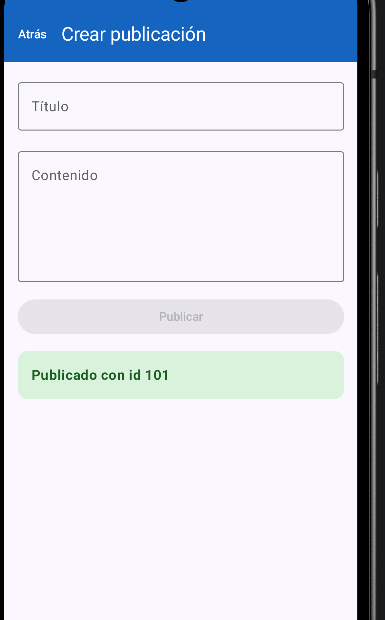
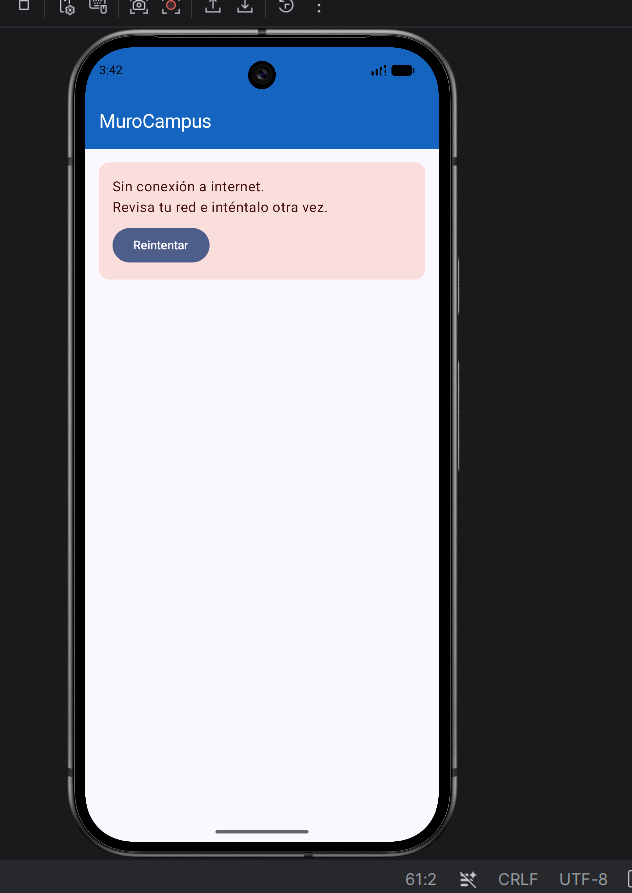

# MuroCampus - Laboratorio 09

## Descripción

MuroCampus es una aplicación móvil desarrollada en Kotlin
con Jetpack Compose que consume un servicio web REST
mediante Retrofit y JSONPlaceholder.

La aplicación permite listar publicaciones, consultar sus
comentarios, filtrar por usuario y crear publicaciones.
También maneja estados de carga, éxito y error de conexión.

## Tecnologías utilizadas

- Kotlin
- Jetpack Compose
- Retrofit
- OkHttp
- Kotlinx Serialization
- Corrutinas
- StateFlow
- Arquitectura MVVM + Repository
- Git y GitHub

## Estructura de paquetes

```text
com.tecsup.murocampus/
├── MainActivity.kt
├── model/
│   └── Modelos.kt
├── data/
│   ├── Errores.kt
│   ├── PostRepository.kt
│   └── remote/
│       ├── PostApi.kt
│       └── RetrofitClient.kt
├── viewmodel/
│   ├── UiState.kt
│   ├── PostsViewModel.kt
│   └── PostsViewModelFactory.kt
└── ui/
    ├── Componentes.kt
    ├── PantallaLista.kt
    ├── PantallaDetalle.kt
    ├── PantallaCrear.kt
    └── theme/
        ├── Color.kt
        ├── Theme.kt
        └── Type.kt
```

## Arquitectura MVVM + Repository



La pantalla se comunica con el ViewModel, el cual utiliza
el Repository para obtener los datos. El Repository realiza
las peticiones mediante Retrofit y devuelve un Result.

El ViewModel transforma el resultado en un UiState que
la interfaz observa mediante collectAsStateWithLifecycle.

## Funcionalidades

- Listado de 100 publicaciones.
- Detalle de publicaciones con sus comentarios.
- Filtro por los 10 usuarios.
- Creación de publicaciones mediante POST.
- Validación de campos obligatorios.
- Estados Cargando, Exito y Error.
- Manejo de errores de conexión y servidor.
- Reintento de peticiones.
- Cancelación de corrutinas.

## Endpoints utilizados

| Método | Ruta | Funcionalidad |
|--------|------|---------------|
| GET | posts | Listar publicaciones |
| GET | posts/{id} | Obtener detalle |
| GET | posts/{id}/comments | Obtener comentarios |
| GET | posts?userId=2 | Filtrar por usuario |
| POST | posts | Crear publicación |

## Capturas de funcionamiento

### 1. Lista de publicaciones

Se muestran las publicaciones obtenidas desde
JSONPlaceholder mediante una petición GET.



### 2. Detalle y comentarios

Se muestra el contenido completo de una publicación
junto con sus cinco comentarios mediante @Path.



### 3. Filtro por usuario

Se muestran únicamente las publicaciones del usuario
seleccionado mediante el parámetro @Query.



### 4. Creación de publicaciones

Se envían los datos mediante POST y @Body.
El servidor responde con el identificador 101.



### 5. Error de conexión

La aplicación muestra un mensaje cuando no existe
conexión a Internet y permite reintentar la petición.



## Pruebas realizadas

| Prueba | Resultado |
|--------|-----------|
| Listar publicaciones | Correcto |
| Consultar detalle y comentarios | Correcto |
| Filtrar por usuario | Correcto |
| Crear publicación | HTTP 201, id 101 |
| Sin conexión a Internet | Mensaje de error |
| Reintentar petición | Correcto |
| Recurso inexistente | HTTP 404 |
| Campo JSON desconocido | Ignorado correctamente |
| Campo JSON obligatorio faltante | Respuesta inesperada |
| Cancelación de corrutinas | Sin cierres inesperados |
| Publicar sin Internet | Conserva los campos escritos |

## Para pensar

### 1. ¿Cuál es la diferencia entre GET y POST?
¿Por qué crear utiliza @Body y porUsuario utiliza @Query?

GET permite consultar información y POST permite enviar
datos para crear un recurso. @Body envía los datos de
la publicación en el cuerpo de la petición, mientras
que @Query agrega un parámetro a la URL para filtrar.

### 2. ¿Por qué la ruta es "posts" y no "/posts"?

Porque "posts" es una ruta relativa que se agrega a
la URL base de Retrofit. Una ruta que comienza con "/"
se resuelve desde la raíz del servidor y puede omitir
los segmentos de ruta de la URL base.

### 3. ¿Por qué el Repository devuelve Result?

Porque permite representar una operación exitosa o
fallida sin obligar al ViewModel a capturar directamente
las excepciones de Retrofit. Esto facilita el manejo
de errores y la separación de responsabilidades.

### 4. ¿Qué sucede sin el permiso INTERNET o sin
ignoreUnknownKeys?

Sin el permiso INTERNET, la aplicación no puede realizar
peticiones al servidor.

Sin ignoreUnknownKeys, la deserialización puede fallar
cuando el servidor devuelve un campo desconocido.

### 5. ¿Por qué utilizar when sobre UiState?

Porque UiState representa estados mutuamente excluyentes:
Cargando, Exito y Error. El when permite mostrar la
interfaz correspondiente sin manejar varias variables
booleanas que podrían generar estados contradictorios.

### 6. ¿Qué cambiaría si se utilizara un servicio real?

Con un servicio real, las publicaciones creadas quedarían
almacenadas en el servidor. La aplicación podría actualizar
la lista después de publicar y recuperar posteriormente
la nueva publicación.

JSONPlaceholder únicamente simula la creación del recurso.

## Conclusiones

- Se implementó el consumo de servicios REST mediante
  Retrofit y OkHttp.
- Se aplicó la arquitectura MVVM + Repository para separar
  la interfaz, la lógica y el acceso a los datos.
- Se manejaron errores de conexión, servidor y serialización.
- Se utilizaron corrutinas y StateFlow para gestionar
  las peticiones y los estados de la aplicación.****