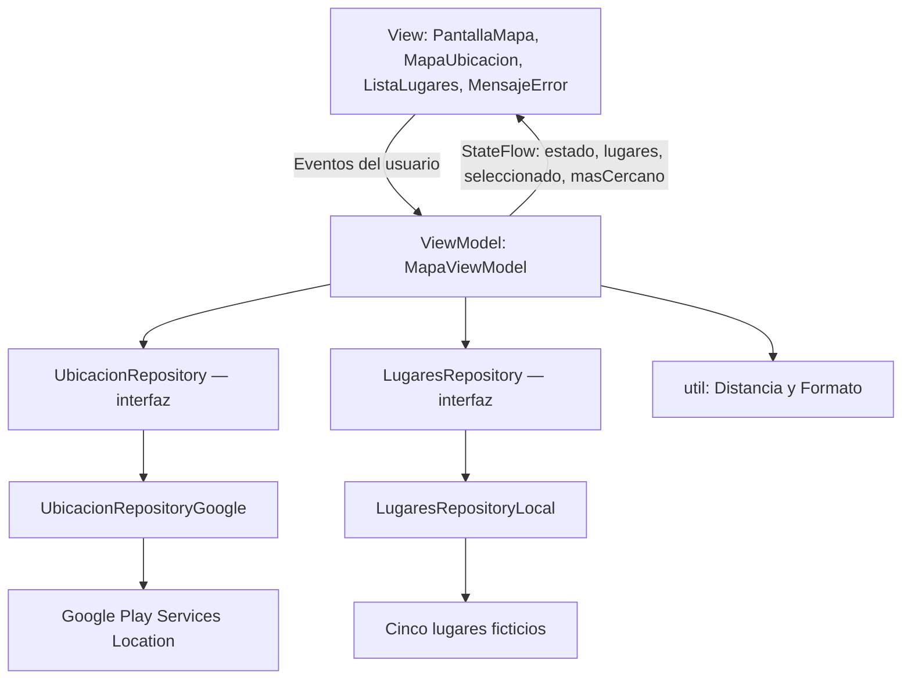
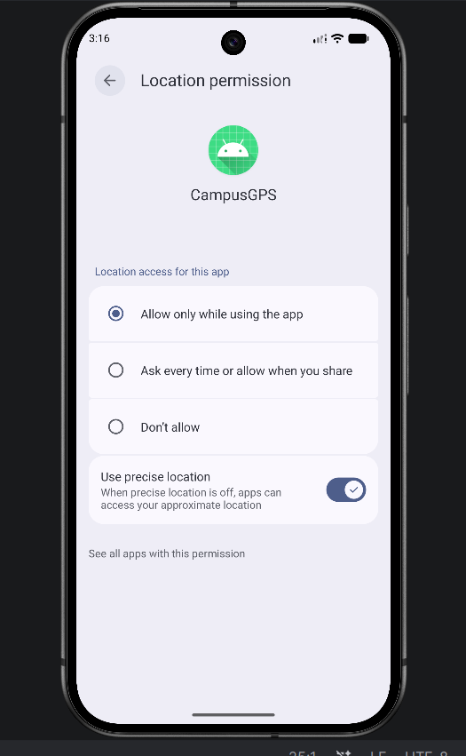
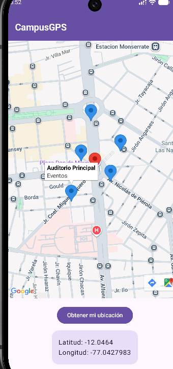
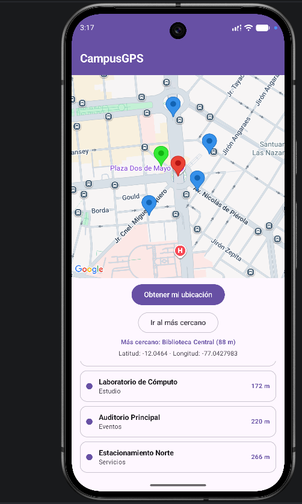
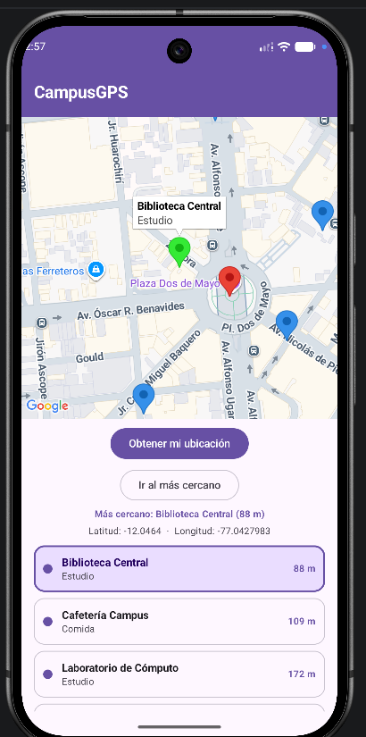
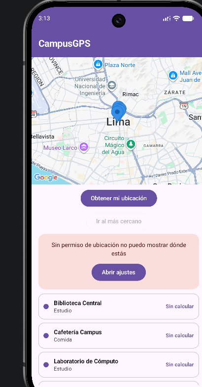

# CampusGPS — Localización Geográfica

Aplicación Android desarrollada en **Kotlin**, **Jetpack Compose** y **Material 3**, que obtiene la ubicación del dispositivo, la muestra sobre Google Maps y calcula qué puntos de un campus ficticio están más cerca del usuario.

**Curso:** Programación en Móviles — Laboratorio 13: Localización Geográfica  
**Paquete:** `com.andia.campusgps`  
**Proyecto:** `ProgMov/Semana13/CampusGPS`

> Los cinco lugares y sus coordenadas son **datos ficticios** utilizados únicamente con fines educativos.

## 1. Objetivo

Implementar una aplicación de localización que solicite permisos en tiempo de ejecución, obtenga coordenadas mediante Google Play Services, visualice un mapa interactivo, ordene lugares por distancia y maneje errores sin cerrar la aplicación.

## 2. Tecnologías

- Kotlin y Android Studio.
- Jetpack Compose y Material 3 (interfaz sin XML de pantallas).
- Google Maps SDK for Android y Maps Compose.
- Google Play Services Location (`FusedLocationProviderClient`).
- Corrutinas, `StateFlow` y `ViewModel`.
- Arquitectura **MVVM + Repository**.
- Git y GitHub para el control de versiones.

## 3. Funcionalidades implementadas

1. Solicitud de permisos `ACCESS_FINE_LOCATION` y `ACCESS_COARSE_LOCATION` durante el uso de la app.
2. Obtención de la ubicación actual y visualización de latitud y longitud.
3. Mapa interactivo con marcador rojo **«Estás aquí»**.
4. Cinco marcadores de lugares ficticios, con nombre y categoría.
5. Cálculo de distancias en metros utilizando `Location.distanceBetween`.
6. Ordenamiento de los lugares del más cercano al más lejano y formato en metros/kilómetros.
7. Lista de lugares seleccionables; al pulsar una tarjeta, se resalta y la cámara se acerca al marcador.
8. Identificación del lugar más cercano con marcador verde y botón **«Ir al más cercano»**.
9. Manejo de permiso denegado, GPS/ubicación no disponible y ausencia de Google Play Services mediante mensajes y acciones apropiadas.

## 4. Lugares ficticios del campus

| ID | Lugar | Categoría | Latitud | Longitud |
|---:|---|---|---:|---:|
| 1 | Biblioteca Central | Estudio | -12.0460 | -77.0435 |
| 2 | Cafetería Campus | Comida | -12.0470 | -77.0420 |
| 3 | Laboratorio de Cómputo | Estudio | -12.0455 | -77.0415 |
| 4 | Auditorio Principal | Eventos | -12.0480 | -77.0440 |
| 5 | Estacionamiento Norte | Servicios | -12.0440 | -77.0430 |

**Coordenada de prueba del emulador:** `-12.0464, -77.0428` (Lima, Perú). Las distancias dependen de la ubicación simulada. En la prueba con ese punto, Biblioteca Central estuvo aproximadamente a **88 m**, Cafetería Campus a **109 m** y Laboratorio de Cómputo a **173 m**.

## 5. Estructura de paquetes

```text
Semana13/CampusGPS/
├── app/
│   ├── build.gradle.kts
│   └── src/main/
│       ├── AndroidManifest.xml
│       └── java/com/andia/campusgps/
│           ├── MainActivity.kt
│           ├── data/
│           │   ├── UbicacionRepository.kt
│           │   ├── UbicacionRepositoryGoogle.kt
│           │   ├── LugaresRepository.kt
│           │   └── LugaresRepositoryLocal.kt
│           ├── model/
│           │   └── Modelos.kt
│           ├── util/
│           │   ├── Distancia.kt
│           │   └── Formato.kt
│           ├── viewmodel/
│           │   ├── MapaViewModel.kt
│           │   └── CampusViewModelFactory.kt
│           └── ui/
│               ├── PantallaMapa.kt
│               ├── MapaUbicacion.kt
│               ├── ListaLugares.kt
│               ├── MensajeError.kt
│               └── theme/
├── gradle/
├── README.md
└── capturas/
    ├── 01-permiso.png
    ├── 02-ubicacion.png
    ├── 03-marcadores.png
    ├── 04-lista-ordenada.png
    └── 05-error.png
```

La carpeta `capturas/` contiene evidencias tomadas durante el desarrollo. La captura `01-permiso.png` muestra los ajustes de permisos de Android, no la ventana emergente de solicitud inicial; esa prueba aún requiere una captura propia si el docente la solicita.

## 6. Arquitectura MVVM + Repository



- **View:** muestra estados y recoge interacciones; no calcula distancias ni accede directamente a los repositorios.
- **ViewModel:** administra el estado mediante `StateFlow`, realiza la selección y organiza las distancias obtenidas con funciones de `util/`.
- **Repository:** abstrae el acceso a Google Play Services y a los lugares locales.
- **util:** contiene las funciones de cálculo y formato de distancia, sin almacenar estado.

## 7. Ejecución

1. Abrir `Semana13/CampusGPS` en Android Studio y sincronizar Gradle.
2. Utilizar un emulador Android compatible con **Google Play Services**.
3. Configurar en Google Cloud un proyecto con **Maps SDK for Android** habilitado y una clave restringida al paquete `com.andia.campusgps` y a la huella SHA-1 de firma correspondiente.
4. Guardar la clave en `local.properties` (en la raíz del proyecto), conservando también `sdk.dir`:

   ```properties
   MAPS_API_KEY=COLOCA_AQUI_TU_CLAVE
   ```

5. Verificar que `local.properties` está excluido de Git mediante `.gitignore`.
6. Ejecutar la app. Para simular la ubicación de prueba: **Extended Controls → Location →** latitud `-12.0464`, longitud `-77.0428` → **Set Location**.
7. Pulsar **«Obtener mi ubicación»** y conceder el permiso.

**Seguridad:** no subir ni compartir claves reales. Si una clave se publica accidentalmente, revocarla o regenerarla y actualizar sus restricciones en Google Cloud.

## 8. Capturas de evidencia

### 8.1 Configuración de permiso en Android



### 8.2 Mapa con ubicación actual



### 8.3 Marcadores de los cinco lugares



### 8.4 Lista ordenada y lugar más cercano



### 8.5 Estado de error




## 9. Pruebas de aceptación

Se realizaron las pruebas funcionales de CampusGPS en el emulador Pixel 9 de Android Studio, comprobando el funcionamiento de las características solicitadas en el laboratorio.

| Prueba requerida | Estado |
|---|---|
| Al iniciar por primera vez, Android solicita el permiso de ubicación. | ✅ Verificado |
| Al conceder el permiso, la aplicación obtiene la ubicación actual. | ✅ Verificado |
| El mapa muestra la posición del usuario con un marcador rojo. | ✅ Verificado |
| Se muestran los cinco marcadores correspondientes a los lugares del campus. | ✅ Verificado |
| Las distancias se calculan correctamente en metros. | ✅ Verificado |
| Las distancias mayores o iguales a 1000 metros se muestran en kilómetros. | ✅ Verificado |
| Los lugares se ordenan de menor a mayor distancia. | ✅ Verificado |
| Al seleccionar una tarjeta, el mapa se desplaza hacia el lugar correspondiente. | ✅ Verificado |
| La tarjeta seleccionada se resalta visualmente. | ✅ Verificado |
| El lugar más cercano se identifica mediante un marcador verde. | ✅ Verificado |
| El botón "Ir al más cercano" permite localizar el lugar correspondiente. | ✅ Verificado |
| Al denegar el permiso, aparece un mensaje con la opción "Abrir ajustes". | ✅ Verificado |
| Al desactivar el GPS, aparece un mensaje con la opción "Reintentar". | ✅ Verificado |
| Al reactivar el GPS, la aplicación recupera la ubicación correctamente. | ✅ Verificado |
| La aplicación mantiene su funcionamiento al rotar la pantalla. | ✅ Verificado |
| La aplicación informa cuando Google Play Services no está disponible. | ✅ Verificado |

**Resultado general:** Las pruebas de aceptación fueron realizadas y verificadas satisfactoriamente. CampusGPS cumple con los requisitos funcionales establecidos para la primera fase del laboratorio.

## 10. Para pensar — Respuestas

### 1. ¿Por qué `FusedLocationProviderClient` está dentro del Repository y no en el ViewModel?

Porque el Repository encapsula el acceso a servicios externos de ubicación. El ViewModel usa la interfaz `UbicacionRepository` y se encarga del estado de la pantalla, sin depender directamente de APIs de Android ni recibir un `Context`. Esto favorece las pruebas, el mantenimiento y el respeto de MVVM.

### 2. ¿Qué diferencia hay entre el permiso de ubicación y la clave de API de Maps? ¿Qué pasa si falta cada uno?

El **permiso de ubicación** es la autorización del usuario para acceder a su posición. Sin él, la app no debe consultar su ubicación y muestra un mensaje con opción de ir a ajustes. La **clave de Maps** autoriza a la aplicación a utilizar el servicio de mapas de Google; si falta o es inválida, el mapa puede quedar gris, no mostrar los mosaicos o producir un error de autorización aunque los permisos de ubicación estén concedidos.

### 3. ¿Por qué la clave va en `local.properties` y no en el código? ¿Qué harías si se subiera a GitHub por error?

Se guarda en `local.properties` para evitar escribirla directamente en archivos que se versionan y reducir la exposición accidental. Ese archivo está excluido mediante `.gitignore`. Si la clave se publicara, se revocaría o regeneraría en Google Cloud, se verificarían sus restricciones de aplicación/API y se eliminaría la credencial expuesta del historial público cuando corresponda.

### 4. ¿Dónde calculas la distancia y por qué no en el Composable?

Se calcula con la función `distanciaMetros()` de `util/Distancia.kt`, llamada desde `actualizarDistancias()` del `MapaViewModel`. El ViewModel ordena y publica la lista mediante `StateFlow`. Los Composables solo observan los datos y los dibujan. Esto evita mezclar lógica de negocio con la interfaz y respeta MVVM.

### 5. ¿Qué pasa con tu app si el usuario niega el permiso dos veces? ¿Cómo lo manejas?

La aplicación permanece abierta y muestra un estado `SIN_PERMISO` con una explicación y el botón **«Abrir ajustes»**. Si Android deja de ofrecer el diálogo de permiso tras denegaciones repetidas, el usuario puede habilitarlo manualmente desde la configuración de la aplicación. No se intenta obtener la posición mientras no haya autorización.

## 11. Control de versiones y entrega

El proyecto se encuentra en el repositorio del curso **ProgMov**, en la carpeta `Semana13/CampusGPS`.

- **Fase 1 (`main`):** 10 commits con los mensajes y el orden indicados por el laboratorio.
- **Fase 2 (`mejora-ia`):** al menos tres mejoras funcionales, tres commits y el registro de asistencia de IA en `PROMPTS.md`.
- **Documentación:** este `README.md`, las cinco capturas y las pruebas de aceptación.

> La Fase 2 se documentará una vez implementada y probada; este README no da esas mejoras por realizadas.
