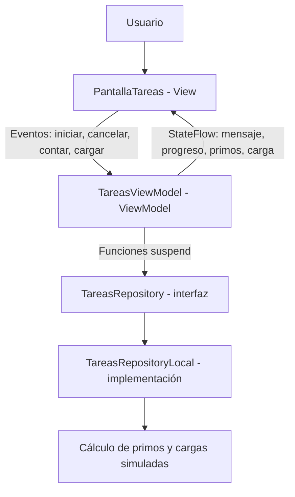
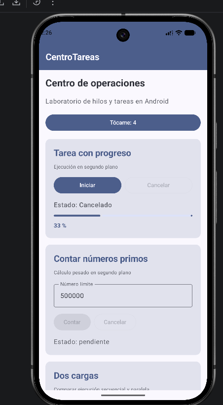

# CentroTareas — Hilos y corrutinas en Android

**Laboratorio 14 · Programación en Móviles**  
**Tecnologías:** Kotlin, Jetpack Compose, Material 3, corrutinas, StateFlow y ViewModel  
**Arquitectura:** MVVM + Repository (interfaz)  
**Repositorio:** [ProgMov / Semana14 / centrotareas](https://github.com/carlosandia-cpu/ProgMov/tree/main/Semana14/centrotareas)

## Descripción

CentroTareas es una aplicación Android que muestra cómo ejecutar operaciones prolongadas sin bloquear el hilo principal. Incluye tres módulos:

1. **Tarea con progreso:** avanza de 0 a 100 % mediante una corrutina y permite cancelar el trabajo.
2. **Contar números primos:** realiza un cálculo intensivo en `Dispatchers.Default`, muestra la cantidad y el tiempo, y admite cancelación.
3. **Dos cargas:** simula obtener un perfil y tres pedidos; compara la ejecución secuencial y la concurrente con `async`, e incorpora errores simulados y reintentos.

El botón **«Tócame»** sirve para verificar que la interfaz continúa respondiendo mientras se ejecutan las tareas.

## Estructura de paquetes

```text
com.andia.centrotareas/
├── MainActivity.kt
├── model/
│   └── Estados.kt
├── data/
│   ├── TareasRepository.kt
│   └── TareasRepositoryLocal.kt
├── viewmodel/
│   ├── TareasViewModel.kt
│   └── TareasViewModelFactory.kt
└── ui/
    ├── PantallaTareas.kt
    └── theme/
        ├── Color.kt
        ├── Theme.kt
        └── Type.kt
```

`MainActivity` inicia la interfaz; `PantallaTareas` muestra los estados y envía los eventos; `TareasViewModel` mantiene los `StateFlow` y las corrutinas; y `TareasRepositoryLocal` implementa las operaciones definidas en `TareasRepository`.

## Diagrama MVVM + Repository



La pantalla no ejecuta directamente operaciones pesadas. El ViewModel gestiona las corrutinas y los estados; el Repository realiza el cálculo de primos y las cargas simuladas.

## Observación del Paso 1 — Congelamiento de la interfaz

En el Paso 1 se utilizó intencionalmente `Thread.sleep(4000)` sobre el hilo principal. Durante esos cuatro segundos la interfaz dejó de responder y el contador «Tócame» no se actualizó. Aunque el mensaje se cambiaba a «Trabajando...», no llegaba a dibujarse mientras el hilo principal estaba bloqueado. Al finalizar se mostró «Terminó».

Si el bloqueo se prolongara, por ejemplo durante más de diez segundos, Android **podría** mostrar el aviso de «La aplicación no responde» (ANR). El tiempo concreto depende del tipo de operación y del sistema.

En los siguientes pasos se reemplazó ese bloqueo por corrutinas con `viewModelScope.launch`, `withContext(Dispatchers.Default)` y `delay`. El Logcat registró la ejecución en `main`, luego en `DefaultDispatcher-worker-1` y finalmente en `main`. Así se verificó el cambio de hilo y que la pantalla seguía respondiendo.

## Evidencias de funcionamiento

### 1. Tarea completada al 100 %

La barra avanza en aproximadamente cuatro segundos y el contador continúa respondiendo.


### 2. Cancelación de la tarea

La tarea se detiene antes de completarse, mantiene el porcentaje alcanzado y muestra el estado «Cancelado».



### 3. Cálculo de números primos

Se comprobaron los resultados `1 000 → 168`, `10 000 → 1 229` y `500 000 → 41 538`. El cálculo puede cancelarse mientras la interfaz permanece activa.


### 4. Comparación: una por una frente a la vez

El perfil simulado demora unos 2 s y los pedidos unos 3 s. La carga secuencial demoró **5 021 ms**, mientras que la concurrente con `async` tardó **3 003 ms** en las pruebas mostradas, con el mismo resultado: Ana Torres (ficticia) y 3 pedidos.

| Secuencial (`Una por una`) | Concurrente (`A la vez`) |
|---|---|
|  |  |

### 5. Error simulado y reintento

Al activar «Simular error», la carga muestra «No se pudo cargar: Sin conexión» en un recuadro de error. Al desactivar el interruptor y pulsar «Reintentar», la carga paralela finaliza correctamente.


## Pruebas de aceptación — Paso 8

Las pruebas marcadas como verificadas se basan en la ejecución, las capturas y las comprobaciones realizadas durante el laboratorio.

| Prueba | Resultado esperado | Estado |
|---|---|---|
| Pulsar «Tócame» durante la tarea | El contador sigue sumando | Verificada |
| Logcat con filtro `HILO` | `main` antes y después; `DefaultDispatcher-worker` dentro | Verificada |
| Iniciar tarea con progreso | De 0 a 100 % en aproximadamente 4 s | Verificada |
| Cancelar a mitad | Se detiene, dice «Cancelado» y puede reiniciarse | Verificada |
| Pulsar Iniciar dos veces | No se ejecutan dos tareas simultáneas; botón deshabilitado | Verificada visualmente |
| Primos hasta 1 000 | 168 | Verificada |
| Primos con N grande | La interfaz responde y Cancelar funciona | Verificada |
| Una por una | Aproximadamente 5 s; perfil y 3 pedidos | Verificada |
| A la vez | Aproximadamente 3 s; perfil y 3 pedidos | Verificada |
| Error simulado + Reintentar | Error rojo y recuperación exitosa | Verificada |
| Rotar durante la tarea | El progreso continúa y no se reinicia | Verificada |
| Buscar llamadas prohibidas en código final | No aparecen `GlobalScope`, `runBlocking` ni `Thread.sleep` en el código final | Verificada (`git grep` sin coincidencias) |

## Para pensar

**1. ¿Por qué no se veía «Trabajando...» en el Paso 1?**  
Porque `Thread.sleep` bloqueaba el hilo principal, encargado también de procesar eventos y dibujar la pantalla. Aunque se cambiara el valor del estado, Android no podía renderizarlo hasta finalizar el bloqueo.

**2. ¿Qué diferencia hay entre `Thread.sleep` y `delay`?**  
`Thread.sleep` bloquea físicamente el hilo durante la espera. `delay` suspende la corrutina sin bloquear el hilo; además, coopera con la cancelación.

**3. ¿Por qué `Dispatchers.Default` para los primos y `Dispatchers.IO` para la red?**  
El cálculo de primos consume CPU, por lo que corresponde a `Dispatchers.Default`. Las operaciones de red o disco son de entrada/salida y, si implican llamadas bloqueantes, se benefician de `Dispatchers.IO`. En este laboratorio la red se simula con `delay`, sin conexión real.

**4. ¿Qué pasaría con la corrutina si el usuario cierra la pantalla? ¿Qué papel cumple `viewModelScope`?**  
`viewModelScope` vincula las corrutinas al ciclo de vida del ViewModel y las cancela cuando este se elimina definitivamente. Una rotación normal conserva el ViewModel, por lo que el progreso debe continuar; cerrar la pantalla definitivamente puede eliminarlo y cancelar sus tareas.

**5. ¿Por qué `async` tarda 3 s y no 5 s? ¿Qué pasa si una de las dos cargas falla?**  
Con `async`, ambas operaciones comienzan concurrentemente: el tiempo total se aproxima al de la más lenta (3 s) en lugar de sumar 2 + 3 s. Si una falla dentro de `coroutineScope`, la excepción se propaga, se cancelan las tareas hermanas aún activas y el ViewModel puede mostrar el estado de error.

## Ejecución

1. Abrir la carpeta `centrotareas` en Android Studio.
2. Sincronizar Gradle y configurar un emulador Android.
3. Ejecutar `app`.
4. Probar los tres módulos y verificar los estados en pantalla.

No se requieren permisos especiales ni conexión a Internet para las cargas simuladas.

## Control de versiones

La Fase 1 se desarrolla en la rama `main`, con nueve commits definidos por el laboratorio. La Fase 2 se desarrolla en `mejora-ia`, con al menos tres mejoras y un registro de prompts en `PROMPTS.md`.
