# CentroTareas — Hilos y corrutinas en Android

| Dato | Detalle |
|---|---|
| Laboratorio | 14 — Programación en Móviles |
| Tecnologías | Kotlin, Jetpack Compose, Material 3, corrutinas, StateFlow y ViewModel |
| Arquitectura | MVVM + Repository (interfaz) |
| Rama base (Fase 1) | [`main`](https://github.com/carlosandia-cpu/ProgMov/tree/main/Semana14/centrotareas) |
| Rama con mejoras (Fase 2) | [`mejora-ia`](https://github.com/carlosandia-cpu/ProgMov/tree/mejora-ia/Semana14/centrotareas) |
| Registro de asistencia de IA | [`PROMPTS.md`](PROMPTS.md) |

## Descripción

CentroTareas es una aplicación Android desarrollada para demostrar la diferencia entre bloquear el hilo principal y ejecutar operaciones prolongadas mediante corrutinas. Se construyó en dos etapas: una **Fase 1** funcional, registrada en `main`, y una **Fase 2** con mejoras asistidas por IA, desarrollada en `mejora-ia`.

La aplicación ofrece tres módulos:

1. **Tarea con progreso:** avanza de 0 a 100 % mediante una corrutina y permite cancelar el trabajo.
2. **Contar números primos:** realiza un cálculo intensivo en `Dispatchers.Default`, informa el progreso real, muestra cantidad y tiempo y admite cancelación.
3. **Dos cargas:** simula obtener un perfil y tres pedidos; compara ejecuciones secuenciales y concurrentes con `async`, mide los tiempos reales y administra errores con reintentos automáticos y manuales.

El botón **«Tócame»** sirve para verificar que la interfaz continúa respondiendo mientras se ejecutan las tareas. En la Fase 2 se añadió una presentación visual con tonos azul noche y turquesa, tarjetas y barras de avance; el rediseño no reemplazó las operaciones de negocio.

## Estructura de paquetes

```text
com.andia.centrotareas/
├── MainActivity.kt
├── model/
│   └── Estados.kt
├── data/
│   ├── TareasRepository.kt
│   └── TareasRepositoryLocal.kt
├── viewmodel/
│   ├── TareasViewModel.kt
│   └── TareasViewModelFactory.kt
└── ui/
    ├── PantallaTareas.kt
    └── theme/
        ├── Color.kt
        ├── Theme.kt
        └── Type.kt
```

`MainActivity` inicia la interfaz; `PantallaTareas` muestra los estados y envía los eventos; `TareasViewModel` mantiene los `StateFlow` y las corrutinas; y `TareasRepositoryLocal` implementa las operaciones definidas en `TareasRepository`.

## Diagrama MVVM + Repository

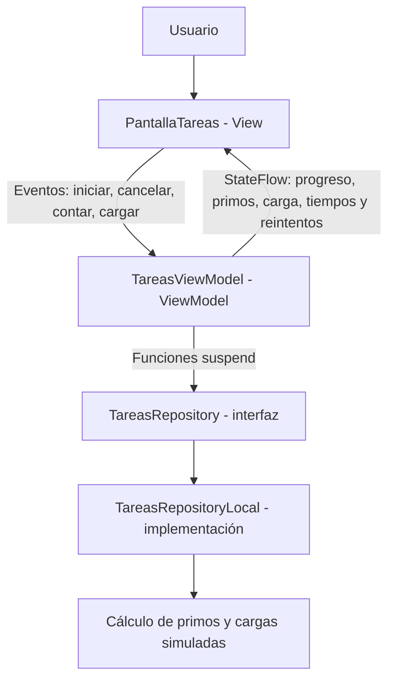

La pantalla no ejecuta directamente operaciones pesadas. El ViewModel gestiona las corrutinas, los estados y las mediciones; el Repository realiza el cálculo de primos y las cargas simuladas. Las operaciones de entrada/salida están simuladas con `delay`; no se consulta un servidor externo.

## Observación del Paso 1 — Congelamiento de la interfaz

En el Paso 1 se utilizó intencionalmente `Thread.sleep(4000)` sobre el hilo principal. Durante esos cuatro segundos la interfaz dejó de responder y el contador «Tócame» no se actualizó. Aunque el mensaje se cambiaba a «Trabajando...», no llegaba a dibujarse mientras el hilo principal estaba bloqueado. Al finalizar se mostró «Terminó».

Si el bloqueo se prolongara, por ejemplo durante más de diez segundos, Android **podría** mostrar el aviso de «La aplicación no responde» (ANR). El tiempo concreto depende del tipo de operación y del sistema.

En los siguientes pasos se reemplazó ese bloqueo por corrutinas con `viewModelScope.launch`, `withContext(Dispatchers.Default)` y `delay`. El Logcat registró la ejecución en `main`, luego en `DefaultDispatcher-worker-1` y finalmente en `main`. Así se verificó el cambio de hilo y que la pantalla seguía respondiendo.

## Evidencias de funcionamiento — Fase 1

### 1. Tarea completada al 100 %

La barra avanza en aproximadamente cuatro segundos y el contador continúa respondiendo.

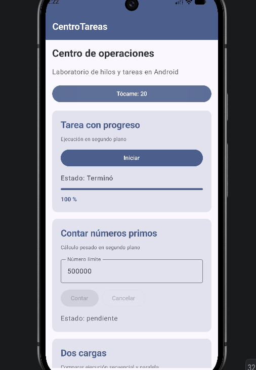

### 2. Cancelación de la tarea

La tarea se detiene antes de completarse, mantiene el porcentaje alcanzado y muestra el estado «Cancelado».


### 3. Cálculo de números primos

Se comprobaron los resultados `1 000 → 168`, `10 000 → 1 229` y `500 000 → 41 538`. El cálculo puede cancelarse mientras la interfaz permanece activa.

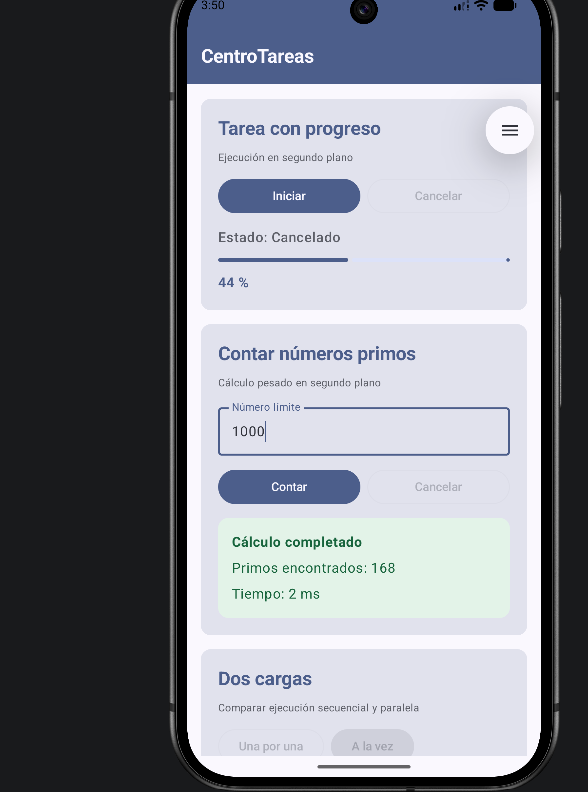
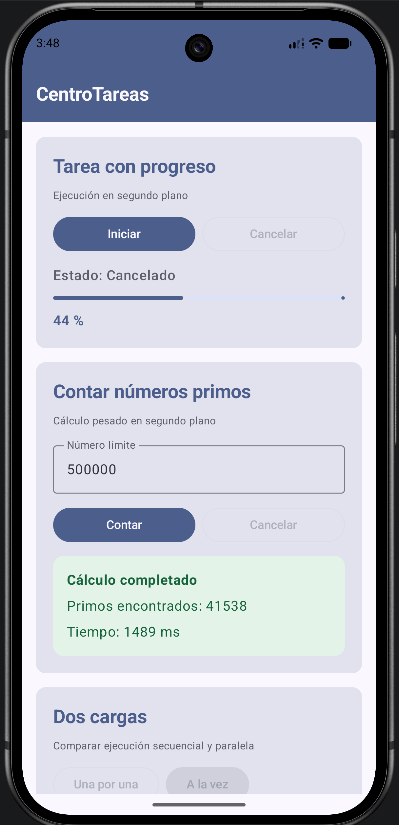
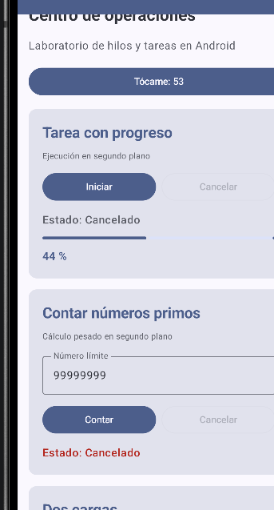

### 4. Comparación: una por una frente a la vez

El perfil simulado demora unos 2 s y los pedidos unos 3 s. La carga secuencial demoró **5 021 ms**, mientras que la concurrente con `async` tardó **3 003 ms** en las pruebas mostradas, con el mismo resultado: Ana Torres (ficticia) y 3 pedidos.

| Secuencial (`Una por una`) | Concurrente (`A la vez`) |
|---|---|
| 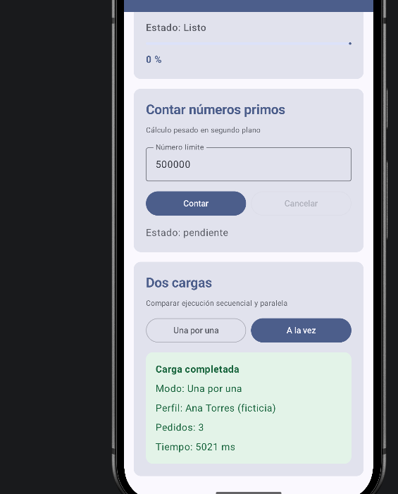 | 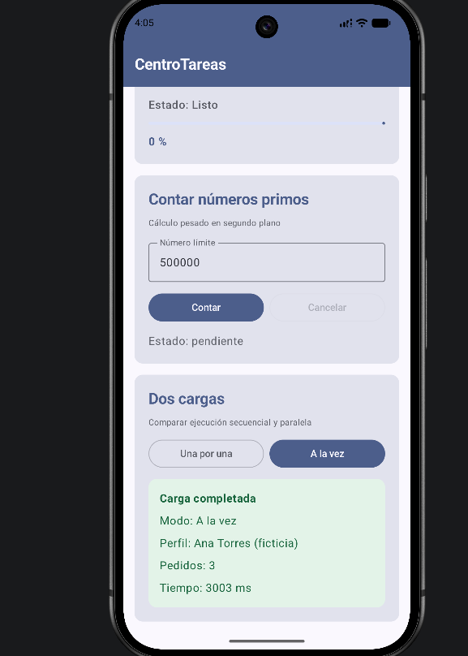 |

### 5. Error simulado y reintento

Al activar «Simular error», la carga muestra «No se pudo cargar: Sin conexión» en un recuadro de error. Al desactivar el interruptor y pulsar «Reintentar», la carga paralela finaliza correctamente.

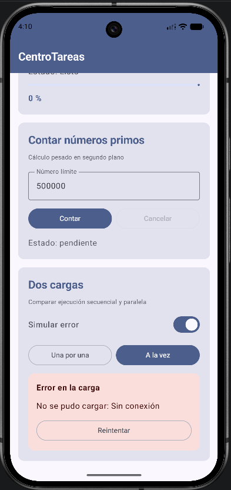
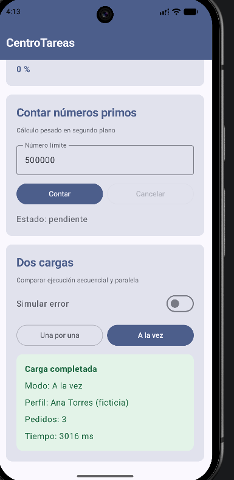

## Fase 2 — Mejoras profesionales asistidas por IA

Las tres mejoras se desarrollaron sobre la aplicación funcional sin sustituir la arquitectura MVVM + Repository. Los prompts enviados a Gemini, las propuestas recibidas, las correcciones efectuadas y sus razones están documentados en [`PROMPTS.md`](PROMPTS.md).

### Mejora 1. Progreso real en el cálculo de números primos

El Repository procesa los números en `Dispatchers.Default` y comunica el porcentaje a la interfaz por medio de `StateFlow`. El avance depende de los números revisados, **no de una barra simulada con `delay`**. Para evitar actualizaciones excesivas, se comunica aproximadamente cada 1 %. El trabajo admite cancelación cooperativa con `ensureActive()`.

- Al iniciar: porcentaje de 0 %.
- Durante el cálculo: porcentaje de trabajo efectivamente procesado.
- Al completar: barra al 100 %, cantidad de primos y tiempo medido.
- Al cancelar: estado «Cancelado» y porcentaje alcanzado, sin sobrescribirlo con un cálculo anterior.

Se observaron los resultados correctos **1 000 → 168 primos** y **5 000 000 → 348 513 primos**. También se verificó una cancelación temprana y avance real durante un cálculo extenso.

| Progreso durante el cálculo | Resultado completo |
|---|---|
| 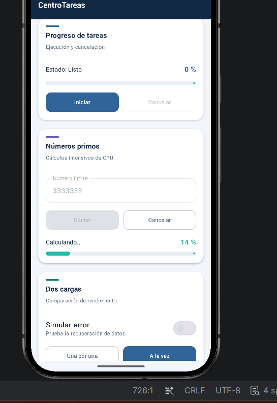 | 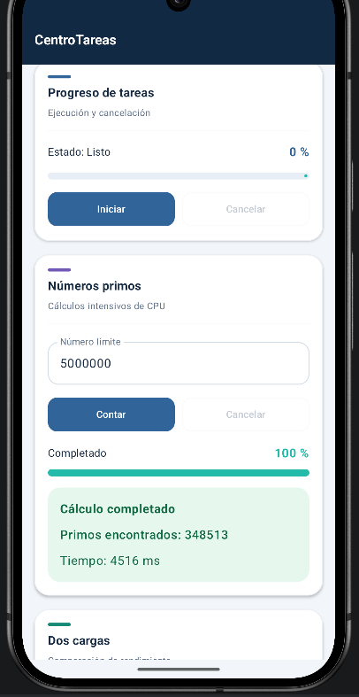 |

### Mejora 2. Comparación visual de rendimiento

El ViewModel mide las duraciones con `SystemClock.elapsedRealtime()`, conserva por separado el último tiempo exitoso de cada modalidad y expone ambos valores mediante `StateFlow`. La tarjeta «Dos cargas» muestra dos barras proporcionales y calcula la diferencia real.

En una ejecución documentada se obtuvieron:

| Modo | Duración observada |
|---|---:|
| Secuencial («Una por una») | 5 021 ms |
| Concurrente («A la vez») | 3 005 ms |
| **Tiempo ahorrado** | **2 016 ms** |
| **Reducción del tiempo respecto al modo secuencial** | **40,2 %** |

La fórmula aplicada es `(tiempoSecuencial - tiempoParalelo) / tiempoSecuencial × 100`. La pantalla informa el resultado real incluso si el modo paralelo resulta más lento. Si falta ejecutar alguna modalidad, aparece una indicación de la medición pendiente. Los fallos no reemplazan los últimos tiempos exitosos.

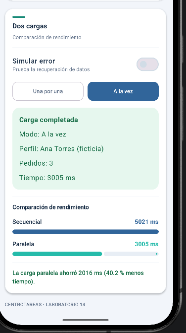

### Mejora 3. Reintentos automáticos ante errores

Cuando una carga genera un error recuperable (`IOException`), la aplicación permite **hasta tres intentos totales**, con esperas de **1 segundo** antes del segundo y **2 segundos** antes del tercero, usando `delay`. La pantalla muestra «Intento N de 3», conserva el indicador de actividad y, tras agotar los intentos, presenta el error definitivo.

El botón **Reintentar** permite ejecutar manualmente otra vez el mismo modo que falló: secuencial o paralelo. La carga concurrente continúa utilizando `async` y `coroutineScope`; los reintentos no convierten los errores en tiempos exitosos. La cancelación de corrutinas se respeta sin reintentar `CancellationException`.

| Intento durante una carga | Error tras tres intentos |
|---|---|
| 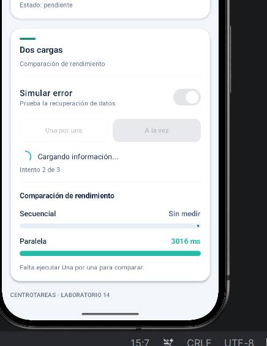 | 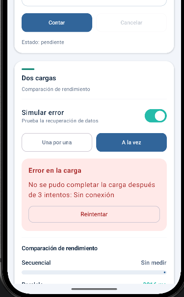 |

Tras desactivar «Simular error», se observó la recuperación de la carga; el resultado se mostró con perfil ficticio, tres pedidos y tiempo real.

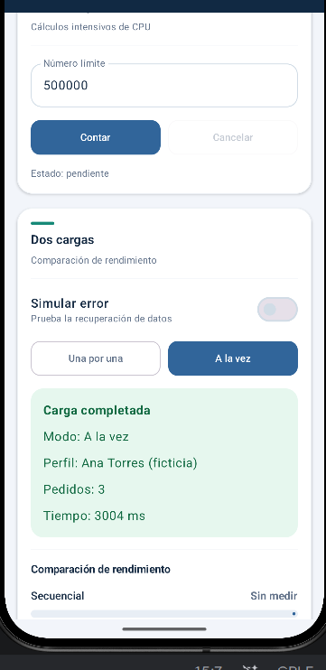

### Resumen de pruebas de la Fase 2

| Escenario | Resultado observado |
|---|---|
| Contar primos hasta 1 000 | 168; progreso al 100 % |
| Contar primos hasta 5 000 000 | 348 513; progreso al 100 % |
| Cancelar un cálculo intensivo | Se conserva el porcentaje y aparece «Cancelado» |
| Pulsar «Tócame» mientras hay tareas en ejecución | La interfaz continúa respondiendo |
| Comparar ambas cargas | Tiempos reales y porcentaje de diferencia correctos |
| Simular error después de medir las cargas | Las barras conservan los últimos tiempos exitosos |
| Ejecutar carga con error recuperable | Se muestran intentos y mensaje final de agotamiento |
| Desactivar error y volver a cargar | Se obtiene un resultado exitoso |
| Repetir carga del modo secuencial | Aproximadamente 5 s sin errores |
| Repetir carga del modo paralelo | Aproximadamente 3 s sin errores |

**Alcance de la evidencia:** las capturas recogen ejecuciones manuales realizadas en el emulador. Los tiempos varían según el dispositivo, y estas verificaciones no sustituyen una batería completa de pruebas automatizadas.

## Pruebas de aceptación — Paso 8

Las pruebas marcadas como verificadas se basan en la ejecución, las capturas y las comprobaciones realizadas durante el laboratorio.

| Prueba | Resultado esperado | Estado |
|---|---|---|
| Pulsar «Tócame» durante la tarea | El contador sigue sumando | Verificada |
| Logcat con filtro `HILO` | `main` antes y después; `DefaultDispatcher-worker` dentro | Verificada |
| Iniciar tarea con progreso | De 0 a 100 % en aproximadamente 4 s | Verificada |
| Cancelar a mitad | Se detiene, dice «Cancelado» y puede reiniciarse | Verificada |
| Pulsar Iniciar dos veces | No se ejecutan dos tareas simultáneas; botón deshabilitado | Verificada visualmente |
| Primos hasta 1 000 | 168 | Verificada |
| Primos con N grande | La interfaz responde y Cancelar funciona | Verificada |
| Una por una | Aproximadamente 5 s; perfil y 3 pedidos | Verificada |
| A la vez | Aproximadamente 3 s; perfil y 3 pedidos | Verificada |
| Error simulado + Reintentar | Error rojo y recuperación exitosa | Verificada |
| Rotar durante la tarea | El progreso continúa y no se reinicia | Verificada |
| Buscar llamadas prohibidas en código final | No aparecen `GlobalScope`, `runBlocking` ni `Thread.sleep` en el código final | Verificada (`git grep` sin coincidencias) |

## Para pensar

**1. ¿Por qué no se veía «Trabajando...» en el Paso 1?**
Porque `Thread.sleep` bloqueaba el hilo principal, encargado también de procesar eventos y dibujar la pantalla. Aunque se cambiara el valor del estado, Android no podía renderizarlo hasta finalizar el bloqueo.

**2. ¿Qué diferencia hay entre `Thread.sleep` y `delay`?**
`Thread.sleep` bloquea físicamente el hilo durante la espera. `delay` suspende la corrutina sin bloquear el hilo; además, coopera con la cancelación.

**3. ¿Por qué `Dispatchers.Default` para los primos y `Dispatchers.IO` para la red?**
El cálculo de primos consume CPU, por lo que corresponde a `Dispatchers.Default`. Las operaciones de red o disco son de entrada/salida y, si implican llamadas bloqueantes, se benefician de `Dispatchers.IO`. En este laboratorio la red se simula con `delay`, sin conexión real.

**4. ¿Qué pasaría con la corrutina si el usuario cierra la pantalla? ¿Qué papel cumple `viewModelScope`?**
`viewModelScope` vincula las corrutinas al ciclo de vida del ViewModel y las cancela cuando este se elimina definitivamente. Una rotación normal conserva el ViewModel, por lo que el progreso debe continuar; cerrar la pantalla definitivamente puede eliminarlo y cancelar sus tareas.

**5. ¿Por qué `async` tarda 3 s y no 5 s? ¿Qué pasa si una de las dos cargas falla?**
Con `async`, ambas operaciones comienzan concurrentemente: el tiempo total se aproxima al de la más lenta (3 s) en lugar de sumar 2 + 3 s. Si una falla dentro de `coroutineScope`, la excepción se propaga, se cancelan las tareas hermanas aún activas y el ViewModel puede mostrar el estado de error.

## Ejecución

1. Abrir `Semana14/centrotareas` en Android Studio y sincronizar Gradle.
2. Comprobar que el SDK esté configurado en el `local.properties` local (no debe subirse a Git).
3. Iniciar un emulador Android (las capturas se obtuvieron en Pixel 9).
4. Ejecutar la configuración `app` o compilar desde la terminal del proyecto:

   ```powershell
   .\gradlew.bat :app:assembleDebug
   ```

5. Probar los tres módulos; para observar progreso real en primos, utilizar un límite suficientemente grande y cancelar antes de que termine.
6. Para comparar tiempos, ejecutar primero «Una por una» y luego «A la vez» con el error desactivado.
7. Para observar los reintentos, activar «Simular error», ejecutar una carga y revisar los estados hasta el fallo final; desactivar el error y volver a cargar.

No se requieren permisos especiales ni conexión a Internet: el perfil y los pedidos son datos ficticios y las esperas están simuladas.

## Control de versiones

### Fase 1 — `main`

La rama `main` contiene los nueve commits exigidos por el laboratorio: importación de la base, demostración del bloqueo de hilo, corrección mediante corrutinas, progreso, cancelación, primos, cargas secuenciales/paralelas, errores y documentación inicial.

### Fase 2 — `mejora-ia`

Se integró `main` mediante un merge y se conservaron los trabajos anteriores de la rama. La aplicación de Semana 14 registra un rediseño visual y tres mejoras funcionales diferenciadas:

| Trabajo | Commit |
|---|---|
| Integración de `main` | `520c91d` — `merge: integra main en mejora-ia con CentroTareas Semana14` |
| Rediseño de CentroTareas | `041e49f` — `style(mejora-ia): moderniza interfaz visual de CentroTareas` |
| Progreso real de primos | `7111698` — `feat(mejora-ia): agrega progreso real al calculo de primos` |
| Comparación de tiempos | `ce6364e` — `feat(mejora-ia): visualiza tiempos de carga` |
| Reintentos automáticos | `feat(mejora-ia): implementa reintentos automaticos` (consultar hash en `git log`) |
| Documentación final de IA | `docs(mejora-ia): documenta mejoras de IA y evidencias` (commit pendiente de crear) |

La trazabilidad de las decisiones de IA se encuentra en [`PROMPTS.md`](PROMPTS.md). El contenido de las dos ramas puede verificarse en el [repositorio ProgMov](https://github.com/carlosandia-cpu/ProgMov).

## Conclusiones

La práctica mostró que una operación extensa en el hilo principal impide responder y dibujar la interfaz. Mediante corrutinas, `viewModelScope`, `Dispatchers.Default`, `StateFlow` y `async`, fue posible ejecutar cálculos y cargas simuladas conservando una interfaz interactiva. Las mejoras añadieron progreso real, comparación de tiempos medidos y reintentos automáticos limitados. La revisión del código propuesto con IA permitió ajustar rendimiento, precisión visual y manejo de errores sin reemplazar la arquitectura inicial.
