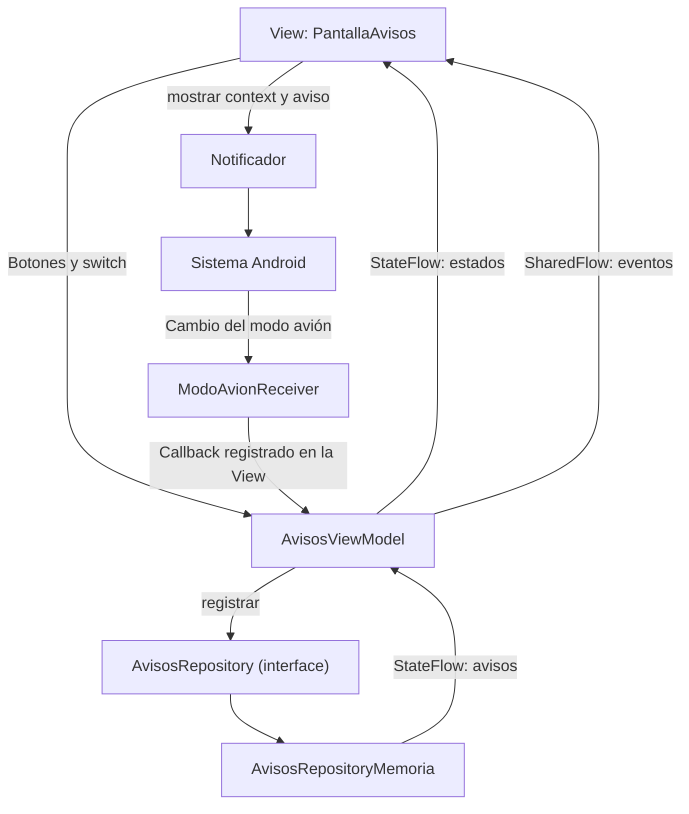
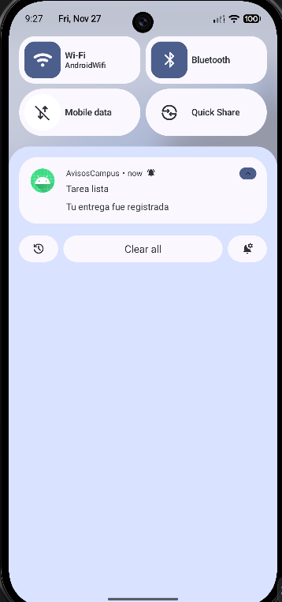
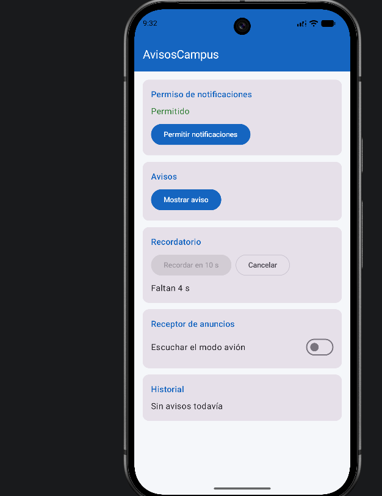
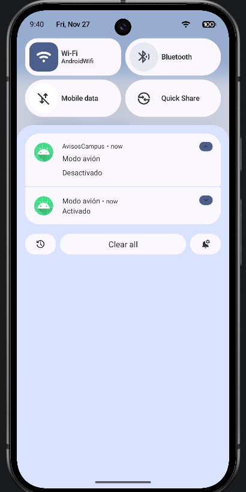
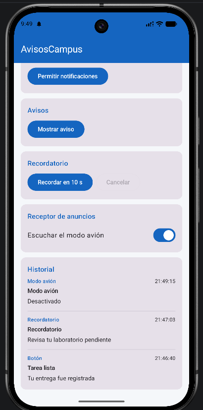
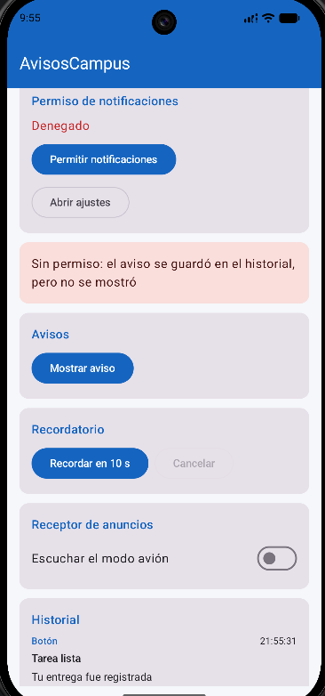

# AvisosCampus — Semana 15

Laboratorio de Programación en Móviles | Notificaciones en Android

## Descripción

AvisosCampus es una aplicación Android que permite mostrar avisos locales, programar un recordatorio de 10 segundos y detectar cambios del modo avión. Los avisos se registran en un historial en memoria, incluso si el permiso de notificaciones está denegado.

## Tecnologías

- Kotlin, Jetpack Compose y Material 3.
- MVVM + Repository mediante una interfaz.
- StateFlow, SharedFlow y corrutinas.
- NotificationCompat, PendingIntent y BroadcastReceiver.

## Funcionalidades

- Canal de notificaciones Avisos y solicitud del permiso POST_NOTIFICATIONS desde Android 13.
- Aviso inmediato: Tarea lista / Tu entrega fue registrada.
- Apertura de la aplicación al tocar una notificación.
- Recordatorio de 10 segundos con cuenta regresiva y cancelación.
- Escucha del modo avión con un switch y registro dinámico del receptor.
- Historial con los 20 avisos más recientes, mostrando origen, título, texto y hora.
- Mensaje de error y acceso a Ajustes cuando el permiso está denegado.

## Estructura de paquetes

```text
com.tecsup.avisoscampus/
├── AvisosApp.kt
├── MainActivity.kt
├── model/
│   └── Modelos.kt
├── data/
│   └── AvisosRepository.kt
├── notificacion/
│   └── Notificador.kt
├── receiver/
│   └── ModoAvionReceiver.kt
├── viewmodel/
│   ├── AvisosViewModel.kt
│   └── AvisosViewModelFactory.kt
└── ui/
    ├── PantallaAvisos.kt
    ├── HistorialAvisos.kt
    └── theme/
        ├── Color.kt
        ├── Theme.kt
        └── Type.kt
```

## Arquitectura MVVM + Repository



El ViewModel controla la lógica y registra los avisos en el Repository. La pantalla observa los estados con `collectAsState()` y recibe los eventos de `SharedFlow`. Como la pantalla dispone de `Context`, llama al Notificador para mostrar la notificación. El ViewModel no utiliza `Context`, `NotificationManager` ni `BroadcastReceiver`.

El receptor se registra cuando se activa el switch y se retira en `onDispose`. El historial se conserva al rotar la pantalla mediante el ViewModel, pero no es persistente si se termina el proceso. El recordatorio utiliza una corrutina del ViewModel; no es una alarma que sobreviva al cierre del proceso.

## Capturas de funcionamiento

### 1. Notificación en el panel

El aviso generado con el botón Mostrar aviso aparece en el panel de Android.



### 2. Recordatorio

La cuenta regresiva muestra los segundos restantes y habilita el botón Cancelar.



### 3. Modo avión

El BroadcastReceiver permite generar avisos al activar y desactivar el modo avión.



### 4. Historial

Se muestran los avisos de botón, recordatorio y modo avión, con el más reciente arriba.



### 5. Permiso denegado

La aplicación muestra el mensaje de error, ofrece el acceso a Ajustes y conserva el aviso en el historial sin mostrar una notificación.



## Para pensar

**1. ¿Para qué sirven el canal y el permiso de notificaciones?**

El canal permite a Android organizar las notificaciones y controlar su importancia. Desde Android 8 es necesario para publicar notificaciones cuando la app apunta a esa versión o superior. Desde Android 13, los avisos normales también requieren el permiso POST_NOTIFICATIONS. Si falta el canal necesario o el permiso, la notificación no se muestra.

**2. ¿Por qué el ViewModel emite un evento en lugar de mostrar la notificación directamente?**

Para separar la lógica de la interfaz y del sistema Android. El ViewModel registra el aviso y emite el evento; la pantalla recibe el evento y llama al Notificador usando su Context. Esto facilita las pruebas y respeta MVVM.

**3. ¿Qué ocurre si dos notificaciones tienen el mismo ID?**

La segunda actualiza o reemplaza a la primera si ambas pertenecen a la misma aplicación y usan la misma etiqueta. Por eso el Repository asigna identificadores diferentes a los avisos durante su vida en memoria.

**4. ¿Por qué onReceive debe ser corto y por qué se retira el receptor?**

Porque se ejecuta normalmente en el hilo principal y no debe bloquearlo con tareas largas. Retirar el receptor evita fugas de memoria y que siga recibiendo eventos cuando ya no se necesita.

**5. ¿Cuándo conviene usar notificaciones locales y cuándo notificaciones push de Firebase?**

Las locales sirven para eventos generados en el dispositivo, como un recordatorio o un cambio del modo avión. Las push sirven para recibir avisos enviados desde un servidor, como mensajes o comunicados nuevos, mediante Firebase Cloud Messaging.

## Ejecución

1. Abrir la carpeta `Semana15/AvisosCampus` en Android Studio.
2. Sincronizar Gradle.
3. Ejecutar en un emulador Android 13 o superior para probar el permiso.
4. Pulsar Permitir notificaciones y probar los avisos, el recordatorio y el modo avión.

## Repositorio y commits

- [Repositorio ProgMov](https://github.com/carlosandia-cpu/ProgMov)
- [Proyecto AvisosCampus en main](https://github.com/carlosandia-cpu/ProgMov/tree/main/Semana15/AvisosCampus)
- [Historial de commits de Semana 15 en main](https://github.com/carlosandia-cpu/ProgMov/commits/main/Semana15/)

Para consultar los hashes y los mensajes de los commits desde la carpeta del proyecto:

```bash
git log --oneline main -- .
```

Para revisar el código modificado en un commit:

```bash
git show HASH_DEL_COMMIT
```
